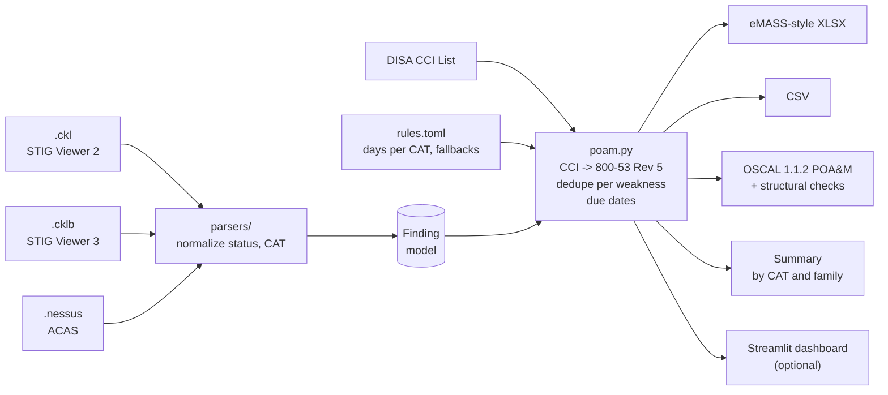

# stig-poam-builder

[](https://github.com/JulietRodriguez/stig-poam-builder/actions/workflows/ci.yml)

Turn DISA STIG checklists and ACAS scan results into POA&Ms automatically.

**In:** STIG Viewer checklists (`.ckl`, `.cklb`) and ACAS/Nessus results (`.nessus`)
**Out:** an eMASS-style POA&M workbook (`.xlsx`), an OSCAL 1.1.2 POA&M (JSON), a CSV, and a summary report

> All data in this repository is synthetic. Do not commit real checklists, scans, or CUI.

## The problem

Every month an ISSO pulls the latest STIG checklists and ACAS scans and rebuilds
the POA&M by hand: filter the Open findings, look up each CCI to find the NIST
control, merge the same finding across dozens of hosts, assign a CAT and a due
date, and type it all into the POA&M template. It is slow, error-prone, and the
same work every month.

stig-poam-builder does that mechanical part in seconds and leaves the risk
judgments to the people accountable for them.

## What it does

- **Parses** STIG Viewer 2 (`.ckl`, XML), STIG Viewer 3 (`.cklb`, JSON), and Nessus v2 (`.nessus`, XML).
- **Normalizes** status (Open / Not a Finding / Not Applicable / Not Reviewed), CAT I/II/III, and Nessus severity (with the plugin's `stig_severity` taking precedence).
- **Maps** STIG findings to **NIST SP 800-53 Rev 5** controls through CCIs, using DISA's CCI List (Rev 4 also supported).
- **Deduplicates** across hosts and files: one POA&M item per weakness, listing every affected device.
- **Schedules** completion dates from configurable days-per-CAT rules.
- **Writes** eMASS-style XLSX, OSCAL 1.1.2 POA&M JSON, CSV, and a Markdown/JSON summary (open findings by CAT and control family, Not Reviewed gaps, mapping warnings).
- **Validates** the OSCAL output's references on every run, and against NIST's official OSCAL JSON Schema in CI.

## Quick start

Requires Python 3.11+.

```bash
git clone https://github.com/JulietRodriguez/stig-poam-builder.git
cd stig-poam-builder
pip install -e .

stig-poam build samples/inputs \
  --cci-list samples/cci/U_CCI_List_SAMPLE.xml \
  --system "Demo System (synthetic)" \
  --as-of 2026-11-17 \
  --out out
```

```text
15 POA&M items (5 CAT I, 7 CAT II, 3 CAT III) from 4 files, 3 hosts
note: 3 checks are Not Reviewed (see summary)
note: CCIs not in the CCI List: CCI-009999
wrote out/poam_2026-11-17.xlsx
wrote out/poam_2026-11-17.csv
wrote out/poam_2026-11-17.oscal.json
wrote out/poam_2026-11-17_summary.md
wrote out/poam_2026-11-17_summary.json
```

### Use the real CCI List

The sample CCI file is a 10-entry excerpt for the demo. For real work, download
the current **CCI List** (`U_CCI_List.xml`) from DISA Cyber Exchange
(*Control Correlation Identifier*) and pass it with `--cci-list`. It isn't
bundled on purpose: DISA updates it, and a stale copy would give wrong mappings
without telling you.

### Options

```text
stig-poam build INPUTS... [--cci-list FILE] [--rules FILE] [--out DIR]
                          [--system NAME] [--as-of YYYY-MM-DD]
                          [--formats xlsx,csv,oscal,summary] [--include-not-reviewed]
stig-poam init-rules > my_rules.toml     # start a rules file from the defaults
stig-poam dashboard                      # optional Streamlit UI
```

`INPUTS` can be files or directories (searched recursively for `.ckl`, `.cklb`, `.nessus`).

### Rules

```toml
[schedule]          # days from the as-of date to the Scheduled Completion Date
cat_i_days = 30     # EXAMPLE values: set these to your AO's policy
cat_ii_days = 90
cat_iii_days = 180

[mapping]
nist_revision = 5               # or 4
stig_unmapped_control = "CM-6"  # when no CCI maps
acas_control = "SI-2"           # ACAS vulnerability findings

[nessus.severity_map]           # Nessus 0-4 -> CAT (stig_severity still wins)
"4" = "CAT I"
"3" = "CAT I"
"2" = "CAT II"
"1" = "CAT III"
```

Any key you leave out keeps its default. Invalid values fail fast with a clear error.

### Dashboard (optional)

```bash
pip install -e ".[dashboard]"
stig-poam dashboard
```

Upload checklists and scans (or use the synthetic samples), adjust the CAT rules,
review counts by CAT and control family, and download every output.

## Sample input and output

A VULN from a sample `.ckl` (abridged):

```xml
<VULN>
  <STIG_DATA><VULN_ATTRIBUTE>Vuln_Num</VULN_ATTRIBUTE><ATTRIBUTE_DATA>V-900007</ATTRIBUTE_DATA></STIG_DATA>
  <STIG_DATA><VULN_ATTRIBUTE>Severity</VULN_ATTRIBUTE><ATTRIBUTE_DATA>high</ATTRIBUTE_DATA></STIG_DATA>
  <STIG_DATA><VULN_ATTRIBUTE>Rule_Ver</VULN_ATTRIBUTE><ATTRIBUTE_DATA>DEMO-OS-000070</ATTRIBUTE_DATA></STIG_DATA>
  <STIG_DATA><VULN_ATTRIBUTE>CCI_REF</VULN_ATTRIBUTE><ATTRIBUTE_DATA>CCI-001453</ATTRIBUTE_DATA></STIG_DATA>
  <STIG_DATA><VULN_ATTRIBUTE>CCI_REF</VULN_ATTRIBUTE><ATTRIBUTE_DATA>CCI-002450</ATTRIBUTE_DATA></STIG_DATA>
  <STATUS>Open</STATUS>
</VULN>
```

The same rule is Open on `web01` (`.ckl`) and `db01` (`.cklb`), so it becomes one POA&M row:

| POA&M Item ID | Controls / APs | CCI | Security Checks | Scheduled Completion Date | Raw Severity | Devices Affected | Comments (excerpt) |
|---|---|---|---|---|---|---|---|
| V-900007 | AC-17(2) | CCI-001453, CCI-002450 | V-900007; SV-900007r10007_rule; DEMO-OS-000070 | 2026-12-17 | High | db01, web01 | Related controls: SC-13. |

Summary excerpt (`samples/outputs/poam_2026-11-17_summary.md`):

| | CAT I | CAT II | CAT III | Total |
|---|---|---|---|---|
| POA&M items | 5 | 7 | 3 | 15 |
| Open instances | 7 | 13 | 6 | 26 |

Full sample outputs (XLSX, CSV, OSCAL JSON, summary) are in [`samples/outputs/`](samples/outputs/).

## Architecture



| Module | Job |
|---|---|
| `parsers/ckl.py`, `cklb.py`, `nessus.py` | Read each format into `Finding` objects |
| `models.py` | `Finding`, `Asset`, status/CAT enums and normalization |
| `cci.py` | Load DISA's CCI List, map CCI -> 800-53 control |
| `config.py` + `data/default_rules.toml` | Configurable rules, validated on load |
| `poam.py` | Filter, map, dedupe, schedule, sort |
| `outputs/` | XLSX, CSV, OSCAL writers; shared column layout |
| `summary.py` | Counts by CAT, family, control; gaps and warnings |
| `pipeline.py`, `cli.py`, `dashboard.py` | Entry points sharing one pipeline |

The reasoning behind each choice is in [`docs/design.md`](docs/design.md).

## About the outputs

**eMASS-style XLSX.** Columns follow publicly documented eMASS POA&M fields.
It is **not** an official DISA or eMASS template; component templates differ, so
check yours before importing. Risk-analysis columns (Likelihood, Impact,
Relevance of Threat, Residual Risk, Mitigations) are left blank on purpose:
those are assessor decisions.

**OSCAL 1.1.2 POA&M.** Each weakness becomes an `observation` (what was seen, on
which hosts), a `risk` (status `open`, `deadline` = due date), a `finding`
(control statement `not-satisfied`), and a `poam-item` linking them. UUIDs are
deterministic, so an item keeps its UUID across monthly runs.

## Limits

- The XLSX is eMASS-*style*. The tool doesn't talk to the eMASS API.
- Each item has one primary control for grouping; other mapped controls are listed, not split into separate items.
- ACAS findings all map to one configurable control (`SI-2`); there is no per-plugin control mapping.
- ACAS *Policy Compliance* (audit) results are skipped. The STIG checklist is treated as the source of truth for configuration findings. There's no correlation between an ACAS plugin and a STIG rule.
- No month-over-month lifecycle: it builds this month's POA&M. Stable item IDs make diffing two runs possible, but closing items is still a human step.
- Due dates are calendar days from the as-of date with one milestone per item.
- SCC/XCCDF result files and Tenable.sc CSV exports aren't parsed yet.
- A reviewer's severity override is shown but doesn't change the due date (see design notes).

## Development

```bash
pip install -e ".[dev]"
pytest --cov                     # 100+ tests: parsers, mapping, dedupe, outputs, CLI
ruff check . && ruff format --check .
python tools/make_samples.py     # regenerate the synthetic inputs

# validate OSCAL output against NIST's schema (downloaded from the OSCAL v1.1.2 release)
curl -sSfL -o schemas/oscal_poam_schema.json \
  https://github.com/usnistgov/OSCAL/releases/download/v1.1.2/oscal_poam_schema.json
python tools/validate_oscal.py --schema schemas/oscal_poam_schema.json out/*.oscal.json
```

CI runs lint, the test suite on Python 3.11 to 3.13 with a coverage floor, OSCAL
schema validation of the sample output, and a headless run of the dashboard.

## References

- DISA STIG Viewer and CKLB JSON schema: DoD Cyber Exchange, *SRG/STIG Tools*
- DISA CCI List: DoD Cyber Exchange, *Control Correlation Identifier (CCI)*
- NIST SP 800-53 Rev 5: <https://csrc.nist.gov/pubs/sp/800/53/r5/upd1/final>
- OSCAL 1.1.2 POA&M model: <https://pages.nist.gov/OSCAL/>, schemas from <https://github.com/usnistgov/OSCAL/releases/tag/v1.1.2>

## License

Apache License 2.0. See [LICENSE](LICENSE).
